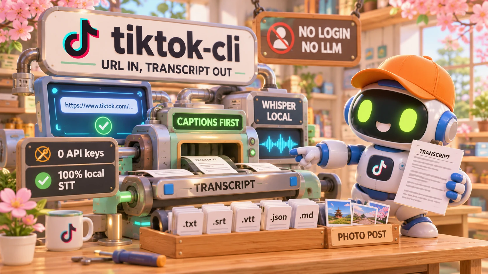

# tiktok-cli

<div align="center">
  
</div>

<div align="center">


</div>

**TikTok URL → transcript files. No login, no LLM, transcription runs locally.**
One command turns any public TikTok video or photo post into `transcript.txt`,
`.srt`, `.vtt`, `.json`, and `.md` plus metadata — caption-first, Whisper
fallback, built so an AI agent can read the output directly.

<div align="center">

```bash
curl -fsSL "https://raw.githubusercontent.com/quangdang46/tiktok_cli/main/install.sh?$(date +%s)" | bash
```

</div>

---

## Agent Quickstart

Built for agents (Claude Code, Codex, Devin, scripts). The contract:

- **stdout carries only results** — one `VIDEO_ID | source | cues=N | dir`
  line per video, or `--json`-style data where offered.
- **stderr carries all diagnostics** — progress bars, warnings, yt-dlp noise.
  Safe to pipe stdout.
- **exit 0 = every URL succeeded**; non-zero if any URL failed (batch isolates
  per-video failures and still exits 0 on partial success).

```bash
# 1. Transcribe — writes ./tiktok-transcripts/VIDEO_ID/
tiktok transcript "https://www.tiktok.com/@user/video/123"

# 2. Read the transcript — plain text, no timestamps, agent-sized
tiktok-transcripts/VIDEO_ID/transcript.txt

# 3. Timestamped + metadata-rich version for citation
tiktok-transcripts/VIDEO_ID/transcript.md

# 4. Machine-readable cue list
tiktok-transcripts/VIDEO_ID/transcript.json   # [{start, end, text}]

# 5. Batch a list of URLs
tiktok batch urls.txt

# 6. Health check before a big run
tiktok doctor
```

**Agent instructions blurb:** *"Run `tiktok transcript <url>`, then read
`tiktok-transcripts/<id>/transcript.txt` (or `.md` for timestamps). Do not
parse stdout for content — it only carries status lines."*

---

## TL;DR

### The Problem

- You find a TikTok worth understanding but won't watch 3 minutes of it.
- Transcript websites require login, upload your link to a third party, or
  watermark/paywall the result.
- Hand-rolling yt-dlp + ffmpeg + Whisper per video means re-solving caption
  quirks, VTT parsing, hallucination settings, and output formats every time.

### The Solution

`tiktok transcript <url>` does the whole pipeline in one shot:

1. Fetch metadata via yt-dlp.
2. **Caption-first** — download TikTok's own caption track when it exists
   (most videos have auto-captions → Whisper never runs).
3. **Whisper fallback** — faster-whisper locally (mlx-whisper on Apple
   Silicon), VAD + anti-hallucination settings.
4. Render `txt`/`srt`/`vtt`/`json`/`md` + `metadata.json`, append
   `index.jsonl`.

Photo/slideshow posts (`/photo/` URLs) get their audio transcribed **and**
their images downloaded — the CLI solves TikTok's public JS challenge to read
the `imagePost` data yt-dlp can't see.

### Why tiktok-cli?

| Capability | tiktok-cli | yt-dlp + whisper (manual) | gerardnico/transcribe | gallery-dl |
|---|---|---|---|---|
| TikTok URL → transcript | ✅ one command | ⚠️ hand-assembled | ✅ | ❌ (media only) |
| Caption-first (skip Whisper) | ✅ | ❌ manual | ✅ | n/a |
| Local STT, no API keys | ✅ faster/mlx-whisper | ✅ | ✅ openai-whisper (heavy) | n/a |
| Output formats txt/srt/vtt/json/md | ✅ all 5 | manual | partial | ❌ |
| Photo-post images + audio | ✅ | ❌ | ❌ | ✅ images only |
| Batch + idempotent index | ✅ `index.jsonl` | ❌ | ⚠️ session cache | ⚠️ |
| Agent contract (stdout/stderr) | ✅ | ❌ | ⚠️ | ❌ |
| No login | ✅ | ✅ | ✅ | ✅ |
| Discovery (search/trending) | ⏸️ suspended | ❌ | ❌ | ⚠️ WAF-limited |

---

## Quick Example

```bash
# Single video — caption path (instant, no Whisper)
tiktok transcript "https://www.tiktok.com/@cnn/video/7489575527632833838"
# → tiktok-transcripts/7489575527632833838/transcript.txt  (40 cues, captions)

# Force Whisper even when captions exist
tiktok transcript <url> --whisper always -m turbo

# Captions only — never spend Whisper compute
tiktok transcript <url> --whisper never

# Photo post — audio transcript + slideshow images
tiktok transcript "https://www.tiktok.com/@user/photo/7707892619572972813"
# → VIDEO_ID/images/image_01.jpg ... + images.json + transcript.*

# Batch from a file (# comments allowed)
tiktok batch urls.txt
# → per-video results + summary table; one bad URL never kills the run

# Re-run is free — already-processed URLs skip instantly
tiktok transcript <url>          # → skipped-cached
tiktok transcript <url> --refresh  # force re-do

# Cookies when TikTok gets picky (optional, never required)
tiktok transcript <url> --cookies-from-browser chrome
```

---

## Commands

| Command | Description | Key flags |
|---------|-------------|-----------|
| `tiktok transcript <urls...>` | Transcribe one or more videos (caption-first, Whisper fallback). | `-o/--output-dir`, `--whisper auto\|always\|never`, `--engine auto\|faster\|mlx`, `-m/--model`, `--format txt\|srt\|vtt\|json\|md\|all`, `--keep-audio`, `--refresh`, `--cookies-from-browser`, `--cookies`, `-v` |
| `tiktok batch <file>` | Process a URL list, one per line (`#` comments allowed); per-video failures don't stop the run. | same pipeline flags as `transcript` |
| `tiktok doctor` | Check yt-dlp, ffmpeg, faster-whisper, mlx-whisper, cached models, `tt`, network, output dir. Exit 1 if a core dep is missing. | — |

> Discovery commands (`info`, `search`, `list`, `tag`, `trending`,
> `discover`) are currently **suspended** — see Limitations.

`transcript` and `batch` share the same option set:

| Flag | Default | Meaning |
|------|---------|---------|
| `-o, --output-dir` | `./tiktok-transcripts` | Artifact root |
| `--whisper` | `auto` | `auto` = Whisper only when no captions; `always` = skip captions; `never` = captions only |
| `--engine` | `auto` | `mlx` on Apple Silicon when installed, else `faster` |
| `-m, --model` | `small` | `tiny` `base` `small` `medium` `large-v3` `turbo` `distil-large-v3`, HF repo, or local path |
| `--format` | `all` | Which transcript files to write |
| `--keep-audio` | off | Keep `audio.*` after Whisper (default: delete) |
| `--refresh` | off | Bypass cache, re-fetch and re-transcribe |
| `-l, --language` | auto | Whisper language hint |
| `--cookies-from-browser` | — | `chrome`/`firefox`/`safari`/... passthrough to yt-dlp |
| `--cookies` | — | Netscape `cookies.txt` file |
| `-v, --verbose` | off | yt-dlp debug output on stderr |

## Output layout

```
tiktok-transcripts/                  # --output-dir
├── VIDEO_ID/                        # yt-dlp info["id"]
│   ├── source.info.json             # raw yt-dlp info (written once)
│   ├── metadata.json                # compact: title, uploader, duration, counts, url
│   ├── subs/                        # raw caption .vtt files from yt-dlp
│   │   └── VIDEO_ID.eng-US.vtt ...
│   ├── audio.*                      # only with --keep-audio (Whisper path)
│   ├── transcript.vtt               # canonical timestamped (caption or whisper)
│   ├── transcript.srt
│   ├── transcript.txt               # plain text, no timestamps — what agents read
│   ├── transcript.json              # [{start, end, text}]
│   ├── transcript.md                # # title + metadata + [mm:ss] cues
│   ├── images/                      # photo posts only: slideshow images
│   │   └── image_01.jpg ...
│   └── images.json                  # photo posts only: image manifest
└── index.jsonl                      # append-only log of every processed video
```

`index.jsonl` records `{video_id, url, status, language, cue_count, duration,
artifact_dir, processed_at}` — enough to build digests or skip processed videos
without a database. Statuses: `caption`, `whisper`, `no-captions`, `no-audio`,
`photo-post`, `skipped-cached`, `failed`.

## Design principles

| Principle | Why |
|-----------|-----|
| Caption-first, Whisper-fallback | Most TikToks ship auto-captions — skips ~90% of STT compute |
| All heavy deps lazy | `tiktok --help` stays fast; faster-whisper/yt-dlp import only when needed |
| stdout = data, stderr = diagnostics | Agents can pipe stdout safely (omni-transcriber constraint) |
| Idempotent by default | `transcript.json` exists → skip; `--refresh` to redo |
| Per-video failure isolation | One bad URL never kills a batch; failures land in `index.jsonl` |
| Honest errors | Private/WAF/rate-limit → clear message + fix hint, never silent empty output |
| No torch, no openai-whisper | faster-whisper's PyAV decodes directly — no ffmpeg extract step required |

## Installation

Requires Python 3.11+. One-liner installers auto-detect `uv` → `pipx` → `pip`:

```bash
# macOS / Linux
curl -fsSL "https://raw.githubusercontent.com/quangdang46/tiktok_cli/main/install.sh?$(date +%s)" | bash

# Windows PowerShell
irm "https://raw.githubusercontent.com/quangdang46/tiktok_cli/main/install.ps1" | iex
```

Installer flags: `--version vX.Y.Z` (pin), `--prefer uv|pipx|pip`,
`--with-mlx` (Apple Silicon Whisper backend), `--verify`, `--uninstall`,
`--quiet`.

Manual equivalents:

```bash
# Recommended: isolated tool install straight from git
uv tool install git+https://github.com/quangdang46/tiktok_cli

# Alternatives
pipx install git+https://github.com/quangdang46/tiktok_cli
pip install git+https://github.com/quangdang46/tiktok_cli
```

This gives you the `tiktok` command. Verify with `tiktok doctor`.

### Optional extras

- **Apple Silicon (macOS arm64):** install the `mlx` extra for the faster
  mlx-whisper backend (auto-selected when available):

  ```bash
  uv tool install --with mlx-whisper git+https://github.com/quangdang46/tiktok_cli
  # or after pip install:
  pip install "tiktok-cli[mlx]"
  ```

  Without it, Whisper falls back to faster-whisper automatically.

## Photo / slideshow posts

`/photo/` URLs are image carousels with an audio track. The CLI:

1. Rewrites the URL to its `/video/` equivalent (yt-dlp's TikTok extractor
   rejects `/photo/` outright, but the same id resolves under `/video/`).
2. Transcribes the audio track like any video.
3. Fetches the post page, solves TikTok's public JS proof-of-work challenge,
   and downloads `imagePost.images` into `VIDEO_ID/images/` with an
   `images.json` manifest (source URLs, dimensions, author, timestamp).

Image download is best-effort: if TikTok changes the challenge format, the
audio transcript still succeeds and a warning goes to stderr.

## Troubleshooting

| Symptom | Cause | Fix |
|---------|-------|-----|
| `Download failed: ... certificate verify failed` | Local TLS-intercepting proxy/AV, or flaky CDN edge | Retry; `curl-cffi` impersonation is already enabled — persistent failures mean network-level interception |
| `private video` / `members-only` / `sign in` | Login-gated content | `--cookies-from-browser chrome` (Safari needs Full Disk Access) or `--cookies cookies.txt` |
| `rate-limit` / `429` | Too many requests | Wait and retry; batch runs are sequential by design |
| Whisper transcript is gibberish on music | No speech — VAD should produce 0 cues | Expected; check `transcript.json` cue count |
| Vietnamese quality poor on `small` | Model too small for Vietnamese | `-m turbo` or `-m large-v3-turbo` (better VN, ~1.5GB download) |
| `no captions - transcribing audio` then slow | Video has no caption track | Normal — first Whisper run downloads the model once |
| `Unsupported URL` on `/photo/` link | Old behavior — fixed in 0.1.0 | Upgrade; `/photo/` posts now work |
| `ffmpeg` WARN in doctor | Not installed | Optional — faster-whisper's PyAV decodes audio directly |
| `mlx-whisper` WARN | Not installed / not arm64 | Optional — auto falls back to faster-whisper |

## Limitations

- **Private, deleted, age-gated, or login-required videos fail.** The CLI
  makes no login flow; `--cookies-from-browser` / `--cookies` are a
  best-effort passthrough and will not bypass everything.
- **TikTok changes its internals often.** Downloading relies on yt-dlp's
  TikTok extractor; when TikTok breaks it, upgrade yt-dlp
  (`uv tool install --force ...`) and run `tiktok doctor` to check versions.
- **Discovery commands are suspended.** `info`, `search`, `list`, `tag`,
  `trending`, and `discover` depend on the external `tt` binary and TikTok's
  web endpoints, which sit behind aggressive anti-bot/WAF protection — in
  practice most IPs get challenged even on the sturdier read path, so the
  commands were removed from the CLI. `transcript`/`batch`/`doctor` are
  unaffected. The code and tests remain in the repo for re-enable.
- **No captions + `--whisper never`** produces `no-captions`: metadata and
  an index entry, but no transcript files.
- **Slideshow images are best-effort.** They depend on TikTok's public JS
  challenge format staying stable; audio transcription is unaffected either way.
- **No LLM features.** This CLI extracts transcripts only; summarization,
  chaptering, and analysis are the caller's job.

## FAQ

**Does it need TikTok login?**
No. Public videos work anonymously. `--cookies-from-browser` exists only as
a fallback for age-gated or flaky-IP situations.

**Does audio leave my machine?**
No. Captions come from TikTok's own subtitle tracks; Whisper runs locally
(faster-whisper or mlx-whisper). Nothing is uploaded anywhere.

**Why caption-first instead of always Whisper?**
TikTok auto-captions cover most videos and are instant + free. Whisper only
runs when no caption track exists (`--whisper auto`, the default).

**Which Whisper model should I use?**
`small` (default, ~466MB) is the speed/quality balance. `turbo` or
`large-v3-turbo` (~1.5GB) is noticeably better for Vietnamese and accented
speech. `tiny`/`base` for quick drafts.

**What does `--whisper never` do?**
Skips Whisper entirely — videos without captions get `no-captions` status
(metadata + index entry only). Use it when you only want free caption
extraction.

**Can I get the images from a photo post?**
Yes — `images/` + `images.json` in the artifact dir. The audio track is
transcribed too (often just music → 0 cues, which is correct).

**Why did my batch exit non-zero?**
`batch` exits 1 only when nothing succeeded *and* at least one URL failed.
Partial success exits 0 — check the summary table and `index.jsonl` for
per-URL status.

**Will TikTok break this?**
Eventually, yes — it's scraping. yt-dlp is actively maintained; run
`tiktok doctor` to check your version and upgrade with
`uv tool install --force git+https://github.com/quangdang46/tiktok_cli`.

## Development

```bash
uv sync                     # install deps + dev extras into .venv
uv run pytest               # 265 tests, zero network, zero model downloads
uv run ruff check .         # lint
uv run ruff format .        # format
uv run tiktok transcript <url>   # run the CLI from source
```

CI runs ruff + pytest on Ubuntu, macOS, and Windows × Python 3.12/3.13.
Integration tests against real TikTok URLs are manual (see PLAN.md §9).

## License

MIT — see [LICENSE](LICENSE).
